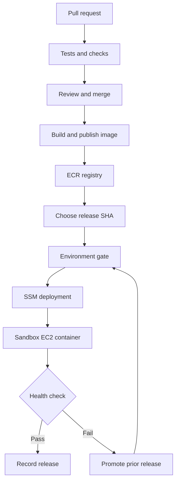

# 10 Days of GitHub Actions 🚀

**A practical CI/CD adventure for developers and DevOps engineers.**

Build one application. Automate its checks. Ship a container. Authenticate to AWS. Deploy, break and recover it. Each day earns up to 100 XP through hands-on evidence—not memorization.

**2–3 hours daily · 10 missions · 1 capstone · 1,000 XP**

> Ten days builds working proficiency and introduces advanced patterns. Production expertise comes from repeated practice and operating real systems.

## Start here

1. Read [setup and publishing](PUBLISH.md).
2. Begin [Day 01](days/day-01.md); activate only that day's workflow.
3. Track your evidence in [PROGRESS.md](PROGRESS.md).
4. Use [TROUBLESHOOTING.md](TROUBLESHOOTING.md) when a mission turns red.

## Choose your pace

- **Core route:** Days 1–6 and 9–10 can be studied without AWS. Practice Docker locally; simulate release decisions.
- **Cloud route:** Add Days 7–8 with your own AWS sandbox. EC2, ECR and networking can incur charges. Follow the cleanup instructions.
- **Stretch route:** Add action SHA pinning, digest-based promotion, a gated Terraform apply design and runner isolation.

## Your mission map

| Day | Mission | What you achieve |
|---|---|---|
| 01 | [Ignition](days/day-01.md) | Make your first pipeline go green, then learn from a red run. |
| 02 | [Gatekeeper](days/day-02.md) | Make checks respond to the right changes. |
| 03 | [Bug Hunter](days/day-03.md) | Catch a real regression before merging. |
| 04 | [Teamwork](days/day-04.md) | Pass information between jobs without guessing. |
| 05 | [Parallel Universe](days/day-05.md) | Run three test lanes and keep evidence. |
| 06 | [Container Captain](days/day-06.md) | Turn tested code into a versioned image. |
| 07 | [Cloud Passport](days/day-07.md) | Give the workflow temporary AWS credentials. |
| 08 | [Mission Control](days/day-08.md) | Deploy a known image and rehearse rollback. |
| 09 | [Automation Architect](days/day-09.md) | Review infrastructure changes and remove repeated YAML. |
| 10 | [Launch Day](days/day-10.md) | Prove you can build, diagnose, ship and recover. |

## The system you are building

The guide implements manual image publication and deployment as separate workflows. The diagram shows the full learning journey; it does not imply that merging automatically deploys. Early lessons publish to GHCR; the AWS track publishes to ECR.

## Inside the kit

| Path | Purpose |
|---|---|
| `days/` | Ten visual lessons, labs, failure drills and answer reveals |
| `examples/` | Workflow templates, inactive until you copy them |
| `app/` | Tiny Python service and unit tests |
| `Dockerfile` | Nonroot teaching container |
| `scripts/deploy_ssm.py` | Remote deployment and health verification |
| `infra/` | No-cloud-resource Terraform practice |
| `AWS-SETUP.md` | OIDC, IAM, ECR and EC2 prerequisites |
| `assets/` | Course cover illustration |

## Learning rhythm

**30 min** understand → **75 min** build → **30 min** troubleshoot → **15 min** explain.

Bring the workflow YAML, run URL, expected behavior and relevant log lines to your trainer. Remove secrets first. Prefer a small diagnosis backed by evidence to random edits.

## Scope and verification

These are teaching examples for GitHub.com and GitHub-hosted Ubuntu runners. Major action tags are readable for learning; pin reviewed full commit SHAs before adopting them in production. Environment protection availability depends on plan and repository visibility; a manual trigger is not equivalent to an enforced independent approval.

Local app tests and package integrity are checked during guide preparation. AWS deployments, GitHub-hosted runs and Terraform execution must be verified in your own configured environment; they are not claimed as already executed.

Read [official references](SOURCES.md) for details. Reference review date: 8 October 2026.

Cover artwork generated for this guide. This is an independent learning resource, not an official GitHub course.
