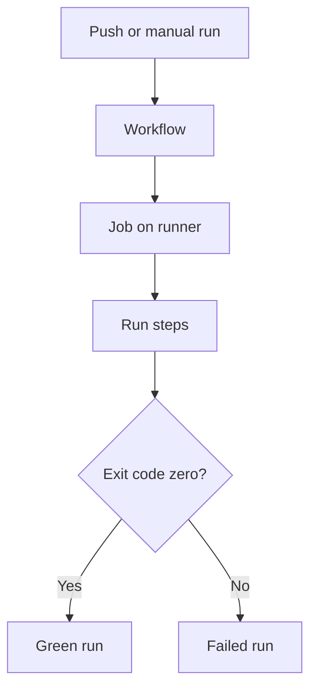

# Day 01 · Ignition

[← Course home](../README.md) · [Course map](../README.md) · [Day 02 →](day-02.md)

**Mission:** Make your first pipeline go green, then learn from a red run.

**Time:** 2–3 hours · **Reward:** 100 XP · **Approach:** build → break → fix → explain

## Understand it

A workflow is the recipe, an event starts it, a job is a unit of work, a runner is the machine, and steps are commands or reusable actions. Jobs can run in parallel; steps inside a job normally run in order. A new hosted job gets a fresh runner, so files do not automatically carry between jobs.

In Jenkins terms: your YAML resembles a Jenkinsfile; `runs-on` selects the agent; `run` resembles a shell step. CI checks changes. Continuous delivery keeps changes ready for release; continuous deployment releases automatically after required checks.

## See it



## Build it

1. Create your training repository and add the files from this package.
2. From the repository root, activate the example:

   ```bash
   mkdir -p .github/workflows
   cp examples/day01.yml .github/workflows/day01.yml
   git add .github/workflows/day01.yml
   git commit -m "Day 1: first workflow"
   git push
   ```

3. Open **Actions → Day 01 - Ignition → latest run → hello**.
4. Expand each step. Find the repository, event and operating-system output.
5. Run it manually from the Actions page. The workflow must exist on the default branch for the manual trigger to appear.

**Workflow:** [day01.yml](../examples/day01.yml). Examples stay inactive until copied into `.github/workflows/`. Commit and push after activation. All commands assume the repository root unless stated otherwise.

## Boss battle: break it and fix it

Change `-eq 10` to `-eq 11`, commit and inspect the failed step. Explain the nonzero exit code, then fix the value.

## Explain it back

Why does GitHub know the repository name even though you did not clone the repository in this job?

<details>
<summary>Reveal the explanation</summary>

GitHub supplies event context and runner environment variables. Downloading your code requires checkout, which we add tomorrow.

</details>

## Claim your XP

- [ ] 40 XP — complete the lab and capture the run link.
- [ ] 30 XP — reproduce and repair the failure.
- [ ] 20 XP — explain the concept in your own words.
- [ ] 10 XP — write one improvement or lesson in your journal.

**Journal:** What changed? What failed? Which log line proved the cause? What did I fix?

[← Course home](../README.md) · [Day 02 →](day-02.md)
