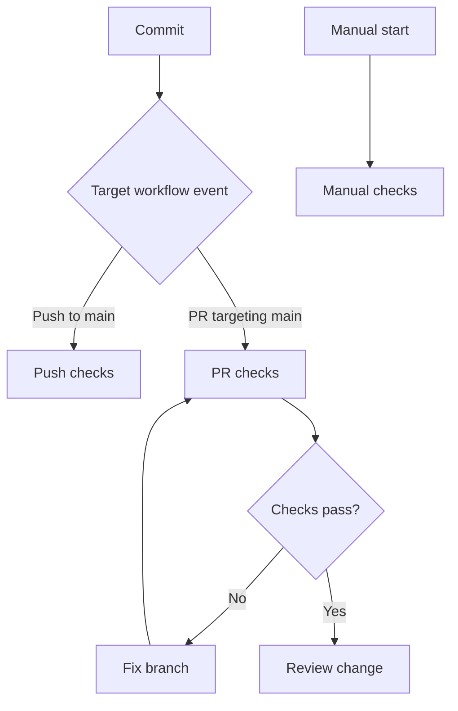

# Day 02 · Gatekeeper

[← Day 01](day-01.md) · [Course map](../README.md) · [Day 03 →](day-03.md)

**Mission:** Make checks respond to the right changes.

**Time:** 2–3 hours · **Reward:** 100 XP · **Approach:** build → break → fix → explain

## Understand it

`push` reacts to commits; `pull_request` checks a proposed change; `workflow_dispatch` is a manual start. For `pull_request`, a branch filter matches the target branch. Branch and path filters, when combined, must both match. A workflow skipped by path filtering can leave a required check pending, so do not casually add path filters to required checks.

## See it

## Build it

1. Copy `examples/day02.yml` into `.github/workflows/day02.yml`; commit it on `main`.
2. Create a branch with `git switch -c day02-trigger-lab`.
3. Edit README, commit, push the branch and open a pull request targeting `main`.
4. Inspect the `pull_request` run and the checkout step.
5. After review, merge the change. Inspect the separate `push` run on `main`.
6. As a temporary experiment, add `paths: ['app/**']` beneath `pull_request`. Compare a docs-only PR with an application PR. Remove this filter before making the workflow a general required check.

**Workflow:** [day02.yml](../examples/day02.yml). Examples stay inactive until copied into `.github/workflows/`. Commit and push after activation. All commands assume the repository root unless stated otherwise.

## Boss battle: break it and fix it

Temporarily change the target branch filter to a nonexistent branch. Observe that no matching run is created; fix the filter. A missing run is different from a failed run.

## Explain it back

What does `branches: [main]` mean under `pull_request`?

Reveal the explanation

The pull request targets main; it does not mean the source branch must be main.

## Claim your XP

- [ ] 40 XP — complete the lab and capture the run link.
- [ ] 30 XP — reproduce and repair the failure.
- [ ] 20 XP — explain the concept in your own words.
- [ ] 10 XP — write one improvement or lesson in your journal.

**Journal:** What changed? What failed? Which log line proved the cause? What did I fix?

[← Day 01](day-01.md) · [Day 03 →](day-03.md)
