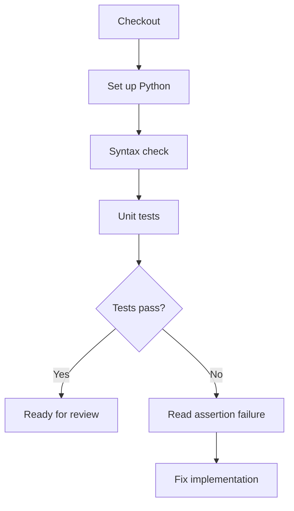

# Day 03 · Bug Hunter

[← Day 02](day-02.md) · [Course map](../README.md) · [Day 04 →](day-04.md)

**Mission:** Catch a real regression before merging.

**Time:** 2–3 hours · **Reward:** 100 XP · **Approach:** build → break → fix → explain

## Understand it

The starter is a tiny Python HTTP service. `/health` reports health, `/` returns a message and unknown routes return 404. Unit tests check the response logic. `compileall` checks syntax; it is not a style linter. `setup-python` selects Python, while checkout downloads repository files.

## See it

## Build it

1. Run `python3 -m unittest discover -s app -v` locally from the repository root.
2. Start the server using `python3 app/app.py`.
3. In a second terminal run `curl http://localhost:8000/health`; stop the server with Ctrl+C.
4. Activate `examples/day03.yml` and push a branch.
5. Open a PR. Locate all three passing tests in the Actions log.
6. Add a new test for an additional response field, implement it, and push again.

**Workflow:** [day03.yml](../examples/day03.yml). Examples stay inactive until copied into `.github/workflows/`. Commit and push after activation. All commands assume the repository root unless stated otherwise.

## Boss battle: break it and fix it

Change the health status code from 200 to 500. Confirm CI fails, then repair the application. Do not weaken the assertion to make broken behavior pass.

## Explain it back

Does a passing unit test prove the deployed server is reachable?

Reveal the explanation

No. Unit tests verify logic; deployment needs a running process and a health check over HTTP.

## Claim your XP

- [ ] 40 XP — complete the lab and capture the run link.
- [ ] 30 XP — reproduce and repair the failure.
- [ ] 20 XP — explain the concept in your own words.
- [ ] 10 XP — write one improvement or lesson in your journal.

**Journal:** What changed? What failed? Which log line proved the cause? What did I fix?

[← Day 02](day-02.md) · [Day 04 →](day-04.md)
