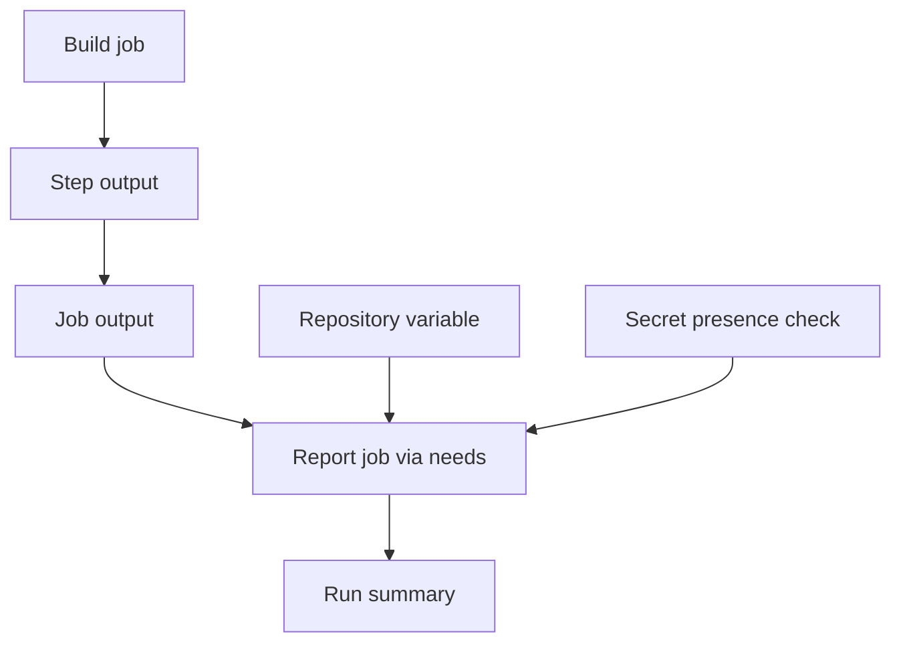

# Day 04 · Teamwork

[← Day 03](day-03.md) · [Course map](../README.md) · [Day 05 →](day-05.md)

**Mission:** Pass information between jobs without guessing.

**Time:** 2–3 hours · **Reward:** 100 XP · **Approach:** build → break → fix → explain

## Understand it

Use `env` for environment variables, `vars` for nonsecret configuration, and `secrets` for sensitive values. A step writes outputs to `$GITHUB_OUTPUT`; a job explicitly exposes them; a downstream job reads them using `needs`. `$GITHUB_ENV` affects later steps in the same job, not other jobs. Inject untrusted text through environment variables rather than embedding it directly in shell code.

## See it

## Build it

1. Under repository **Settings → Secrets and variables → Actions**, add variable `COURSE_NAME=10 Days of GitHub Actions`.
2. Add secret `DEMO_TOKEN` with a made-up training value, not a real credential.
3. Activate `examples/day04.yml` and run it manually.
4. Open the run summary; compare the reported version with the commit SHA.
5. Remove the demo secret and rerun to see a useful failure, then restore it.
6. Add a reporting job with `if: always()` and `needs: [build, report]` to learn how failed dependencies normally cause skips.

**Workflow:** [day04.yml](../examples/day04.yml). Examples stay inactive until copied into `.github/workflows/`. Commit and push after activation. All commands assume the repository root unless stated otherwise.

## Boss battle: break it and fix it

Rename the step ID but leave the output expression unchanged. Inspect the missing output, then restore the matching ID.

## Explain it back

Why does exporting a shell variable in one job not pass it to another?

Reveal the explanation

Jobs have separate execution environments. Use job outputs for small values and artifacts for files.

## Claim your XP

- [ ] 40 XP — complete the lab and capture the run link.
- [ ] 30 XP — reproduce and repair the failure.
- [ ] 20 XP — explain the concept in your own words.
- [ ] 10 XP — write one improvement or lesson in your journal.

**Journal:** What changed? What failed? Which log line proved the cause? What did I fix?

[← Day 03](day-03.md) · [Day 05 →](day-05.md)
