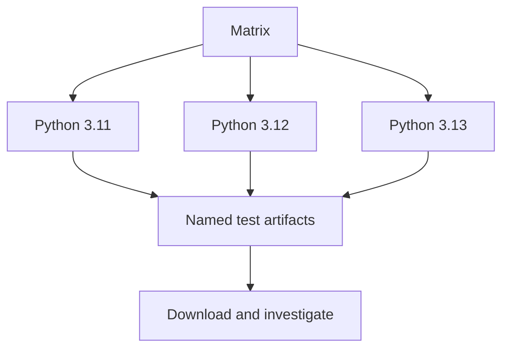

# Day 05 · Parallel Universe

[← Day 04](day-04.md) · [Course map](../README.md) · [Day 06 →](day-06.md)

**Mission:** Run three test lanes and keep evidence.

**Time:** 2–3 hours · **Reward:** 100 XP · **Approach:** build → break → fix → explain

## Understand it

A matrix repeats a job for different inputs. `fail-fast: false` lets the other lanes finish after one fails. Artifacts preserve outputs such as reports. Caches speed up repeat dependency downloads and must never be required for correctness. This app uses the Python standard library, so it has no dependency cache to warm by default.

## See it

## Build it

1. Activate `examples/day05.yml`. Inspect the three parallel lanes.
2. Download a test artifact from the run summary.
3. Break one assertion; verify that logs still upload because the upload step uses `if: always()`.
4. Notice each artifact name includes the Python version to avoid collisions.
5. Cache extension: add a `requirements-dev.txt` with a reviewed, exact pytest version. In setup-python add `cache: pip` and `cache-dependency-path: requirements-dev.txt`. Add `python -m pip install -r requirements-dev.txt`, then run `python -m pytest app`.
6. Run twice and inspect cache restore messages. Pip's download cache does not replace dependency installation; keep the install step.

**Workflow:** [day05.yml](../examples/day05.yml). Examples stay inactive until copied into `.github/workflows/`. Commit and push after activation. All commands assume the repository root unless stated otherwise.

## Boss battle: break it and fix it

Remove `set -o pipefail` and explicitly set the shell to `bash {0}` in a temporary experiment. A successful `tee` can hide a failing test command. Restore the supplied shell and pipefail handling.

## Explain it back

Can a cache miss be allowed to break CI?

Reveal the explanation

No. A correct workflow reinstalls dependencies on a miss; a cache is an optimization.

## Claim your XP

- [ ] 40 XP — complete the lab and capture the run link.
- [ ] 30 XP — reproduce and repair the failure.
- [ ] 20 XP — explain the concept in your own words.
- [ ] 10 XP — write one improvement or lesson in your journal.

**Journal:** What changed? What failed? Which log line proved the cause? What did I fix?

[← Day 04](day-04.md) · [Day 06 →](day-06.md)
