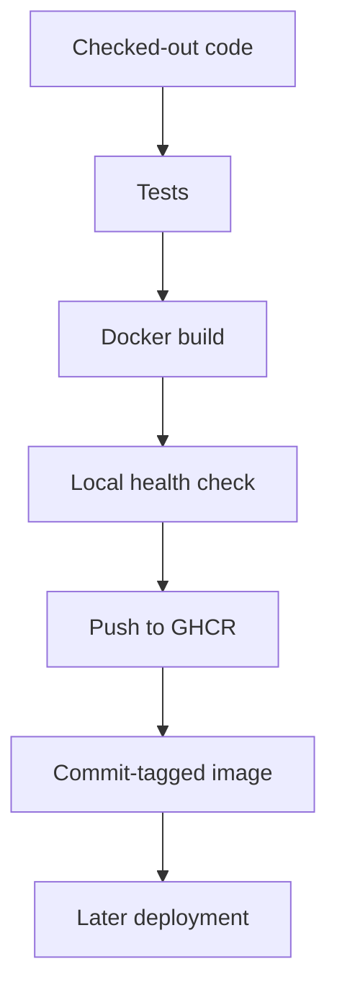

# Day 06 · Container Captain

[← Day 05](day-05.md) · [Course map](../README.md) · [Day 07 →](day-07.md)

**Mission:** Turn tested code into a versioned image.

**Time:** 2–3 hours · **Reward:** 100 XP · **Approach:** build → break → fix → explain

## Understand it

An image is a packaged application and runtime; a container is a running instance. A registry stores images. A commit-based tag connects code to an image but tags can still be overwritten unless the registry prevents it. Production promotion should use the resolved image digest. This teaching Dockerfile uses a nonroot user.

## See it

## Build it

1. Install/start Docker locally, or use a disposable Linux development machine.
2. Run `docker build -t bootcamp:local .`.
3. Run `docker run --rm -d --name bootcamp-local -p 127.0.0.1:8080:8000 bootcamp:local`.
4. Run `curl -f http://localhost:8080/health`, then `docker stop bootcamp-local`.
5. Activate `examples/day06.yml`. Push to main or run manually.
6. Read the image name in the workflow summary and locate it in GitHub Packages.
7. If push is denied, check organization policy, `packages: write`, and existing package access. The workflow lowercases the image path automatically.
8. Extension: reproduce the local container health check in the workflow before pushing.

**Workflow:** [day06.yml](../examples/day06.yml). Examples stay inactive until copied into `.github/workflows/`. Commit and push after activation. All commands assume the repository root unless stated otherwise.

## Boss battle: break it and fix it

Use the wrong container port in the local `docker run` command. Diagnose the failed curl using `docker ps` and `docker logs`, then restore 8080:8000.

## Explain it back

Why avoid deploying `latest` when practicing rollback?

Reveal the explanation

It does not identify a specific release. A commit tag is traceable; an immutable digest is stronger.

## Claim your XP

- [ ] 40 XP — complete the lab and capture the run link.
- [ ] 30 XP — reproduce and repair the failure.
- [ ] 20 XP — explain the concept in your own words.
- [ ] 10 XP — write one improvement or lesson in your journal.

**Journal:** What changed? What failed? Which log line proved the cause? What did I fix?

[← Day 05](day-05.md) · [Day 07 →](day-07.md)
