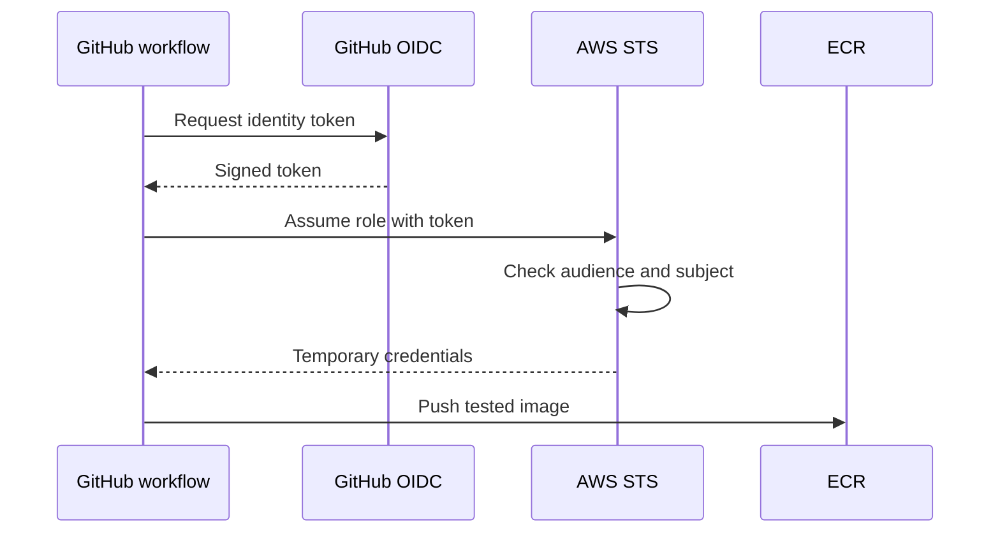

# Day 07 · Cloud Passport

[← Day 06](day-06.md) · [Course map](../README.md) · [Day 08 →](day-08.md)

**Mission:** Give the workflow temporary AWS credentials.

**Time:** 2–3 hours · **Reward:** 100 XP · **Approach:** build → break → fix → explain

## Understand it

OIDC lets GitHub prove workflow identity to AWS. AWS STS checks the role trust policy and returns temporary credentials. `id-token: write` permits requesting an OIDC token; it does not grant AWS permissions by itself. IAM role permissions separately control allowed AWS API calls.

## See it

## Build it

1. Follow [AWS setup](../AWS-SETUP.md), including OIDC, ECR and a restricted publisher role.
2. Add repository variables `AWS_REGION`, `AWS_ROLE_ARN`, `ECR_REGISTRY` and `ECR_REPOSITORY`.
3. Activate `examples/day07.yml` on main.
4. Run manually on main. Compare `get-caller-identity` with the intended sandbox account and role.
5. Confirm the ECR image tag equals the workflow commit SHA.
6. Record this SHA for tomorrow. Never paste temporary credentials into your learning journal.
7. If assumption fails, compare audience, repository owner/name, branch, and role ARN exactly.

**Workflow:** [day07.yml](../examples/day07.yml). Examples stay inactive until copied into `.github/workflows/`. Commit and push after activation. All commands assume the repository root unless stated otherwise.

## Boss battle: break it and fix it

Run on another branch and observe the job-level main-branch condition skipping it. Explain how the IAM subject restriction provides an additional independent boundary.

## Explain it back

Why are trust policy and permissions policy both required?

Reveal the explanation

Trust defines who can assume the role; permissions define what that role can do after assumption.

## Claim your XP

- [ ] 40 XP — complete the lab and capture the run link.
- [ ] 30 XP — reproduce and repair the failure.
- [ ] 20 XP — explain the concept in your own words.
- [ ] 10 XP — write one improvement or lesson in your journal.

**Journal:** What changed? What failed? Which log line proved the cause? What did I fix?

[← Day 06](day-06.md) · [Day 08 →](day-08.md)
