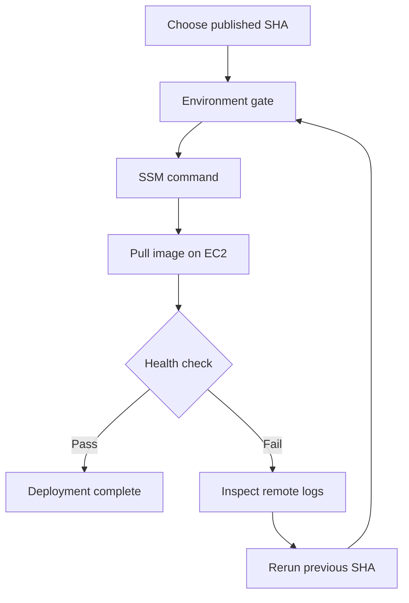

# Day 08 · Mission Control

[← Day 07](day-07.md) · [Course map](../README.md) · [Day 09 →](day-09.md)

**Mission:** Deploy a known image and rehearse rollback.

**Time:** 2–3 hours · **Reward:** 100 XP · **Approach:** build → break → fix → explain

## Understand it

The supplied workflow manually promotes a previously published commit-tagged ECR image. This is continuous delivery with an explicit release step. It uses SSM instead of SSH. A deployment is successful only when the remote command completes and the health check passes. This single-instance lab has brief downtime and manual rollback; it is not a high-availability deployment.

## See it

## Build it

1. Complete the EC2 and deployment-role sections of [AWS setup](../AWS-SETUP.md).
2. Create the `sandbox` GitHub environment and restrict deployments to main. Add a required reviewer if supported by your GitHub plan and repo visibility.
3. Add `AWS_DEPLOY_ROLE_ARN` and `EC2_INSTANCE_ID`; retain the ECR and region variables from Day 7.
4. Activate `examples/day08.yml` and run it on main with Day 7's full SHA.
5. Approve the environment gate if configured. Inspect the SSM command ID and health output.
6. Make a harmless change to the home message, rerun Day 7, then deploy the new SHA.
7. Roll back by rerunning Day 8 with the previous known-good SHA; confirm the old message using SSM and curl on the instance.
8. Capture both deployment run links in your journal.

**Workflow:** [day08.yml](../examples/day08.yml). Examples stay inactive until copied into `.github/workflows/`. Commit and push after activation. All commands assume the repository root unless stated otherwise.

## Boss battle: break it and fix it

In the sandbox, use a valid-looking but nonexistent SHA. The image pull should fail before the current container is removed. Inspect SSM output and rerun a real SHA.

## Explain it back

Is obtaining an SSM command ID enough to claim deployment success?

Reveal the explanation

No. SendCommand is asynchronous; poll its result and check the service health.

## Claim your XP

- [ ] 40 XP — complete the lab and capture the run link.
- [ ] 30 XP — reproduce and repair the failure.
- [ ] 20 XP — explain the concept in your own words.
- [ ] 10 XP — write one improvement or lesson in your journal.

**Journal:** What changed? What failed? Which log line proved the cause? What did I fix?

[← Day 07](day-07.md) · [Day 09 →](day-09.md)
