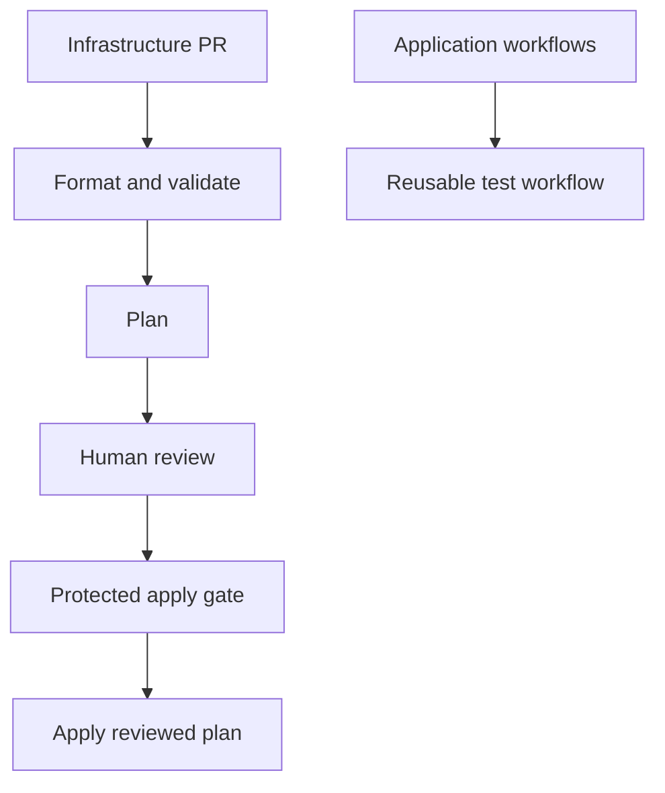

# Day 09 · Automation Architect

[← Day 08](day-08.md) · [Course map](../README.md) · [Day 10 →](day-10.md)

**Mission:** Review infrastructure changes and remove repeated YAML.

**Time:** 2–3 hours · **Reward:** 100 XP · **Approach:** build → break → fix → explain

## Understand it

Terraform plan proposes changes; apply performs them. The included `terraform_data` lab uses Terraform's built-in provider and creates no AWS resources. It introduces the workflow mechanics without cloud cost. Reusable workflows share jobs; composite actions share a sequence of steps inside a job.

## See it

## Build it

1. Activate `examples/day09.yml` and run it manually.
2. Inspect format, init, validate and plan logs. This supplied workflow deliberately stops at plan.
3. Locally install Terraform 1.10.5, `cd infra`, then run `terraform init`, `terraform plan -out=demo.tfplan`, and `terraform apply demo.tfplan`. Confirm the output, then `terraform destroy`.
4. Do not commit state or saved plans. The ignore file excludes them.
5. Copy `examples/reusable-tests.yml` into `.github/workflows/reusable-tests.yml` and use Day 10's caller to invoke it.
6. Advanced design exercise: describe how an AWS workflow uses restricted OIDC roles, encrypted remote state and locking, protected environments, concurrency and a saved plan tied to the reviewed commit.
7. For a real apply workflow, require approval, apply the exact reviewed plan to the intended state, and handle stale-plan failures by replanning and reviewing. Do not automatically apply untrusted PR code.

**Workflow:** [day09.yml](../examples/day09.yml). Examples stay inactive until copied into `.github/workflows/`. Commit and push after activation. All commands assume the repository root unless stated otherwise.

## Boss battle: break it and fix it

Misformat `infra/main.tf` and observe `fmt -check` fail. Repair with `terraform fmt`; review the diff before committing.

## Explain it back

Why is an approval followed by an unrelated fresh plan not equivalent to applying the reviewed plan?

Reveal the explanation

The proposed changes can differ. Bind approval to the commit and plan, and invalidate stale plans.

## Claim your XP

- [ ] 40 XP — complete the lab and capture the run link.
- [ ] 30 XP — reproduce and repair the failure.
- [ ] 20 XP — explain the concept in your own words.
- [ ] 10 XP — write one improvement or lesson in your journal.

**Journal:** What changed? What failed? Which log line proved the cause? What did I fix?

[← Day 08](day-08.md) · [Day 10 →](day-10.md)
