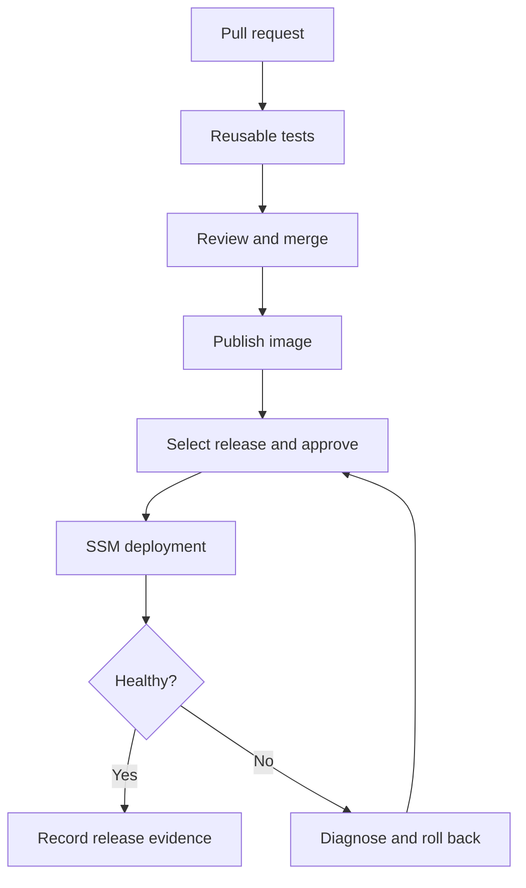

# Day 10 · Launch Day

[← Day 09](day-09.md) · [Course map](../README.md) · [Finish scorecard →](../PROGRESS.md)

**Mission:** Prove you can build, diagnose, ship and recover.

**Time:** 2–3 hours · **Reward:** 100 XP · **Approach:** build → break → fix → explain

## Understand it

Your final project combines CI, image publication, OIDC and an explicit deployment step. Keeping release promotion manual makes the handoff visible. Advanced topics introduced here need repeated practice before production ownership: supply-chain controls, self-hosted runner isolation, deployment strategies and state management.

## See it

## Build it

1. Activate both `examples/reusable-tests.yml` and `examples/day10.yml` under `.github/workflows/`.
2. Remove or deactivate redundant early-day workflows to keep the final repository focused. Keep reusable tests, Day 7 publication, Day 8 deployment and Day 9 plan as appropriate.
3. Open a PR changing the home response and its test. Demonstrate a failure and a repair.
4. Merge after review, publish the exact merged commit using Day 7, then deploy using Day 8.
5. Demonstrate rollback and record the old/new SHA, run links, result and diagnosis.
6. Harden the examples: pin actions to reviewed full commit SHAs, use an image digest for promotion, add dependency updates, keep token permissions minimal, and document an isolated runner policy.
7. Explain why untrusted fork PRs must never execute with deployment credentials. Avoid privileged `pull_request_target` workflows that check out and execute PR code.
8. Complete [the scorecard](../PROGRESS.md) and describe the architecture without reading YAML.

**Workflow:** [day10.yml](../examples/day10.yml). Examples stay inactive until copied into `.github/workflows/`. Commit and push after activation. All commands assume the repository root unless stated otherwise.

## Boss battle: break it and fix it

Choose one incident: missing secret, wrong OIDC subject, nonexistent image, skipped dependency or failed health check. Diagnose it from logs without changing multiple things at once.

## Explain it back

What is the difference between your capstone and a production-grade delivery platform?

Reveal the explanation

This lab is single-instance with manual promotion and rollback. Production adds tested recovery, immutable promotion, stronger review controls, monitoring, availability and organizational policy enforcement.

## Claim your XP

- [ ] 40 XP — complete the lab and capture the run link.
- [ ] 30 XP — reproduce and repair the failure.
- [ ] 20 XP — explain the concept in your own words.
- [ ] 10 XP — write one improvement or lesson in your journal.

**Journal:** What changed? What failed? Which log line proved the cause? What did I fix?

[← Day 09](day-09.md) · [Finish scorecard →](../PROGRESS.md)
